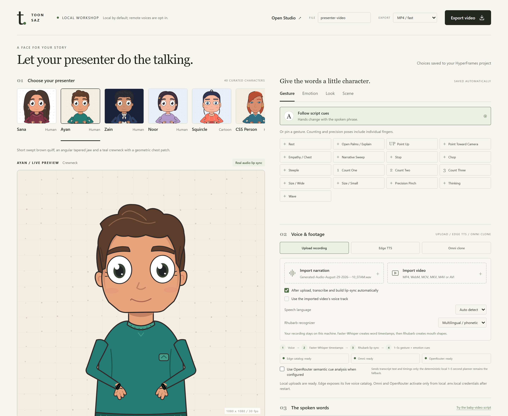

# ToonSaz

**Turn a script into a lip-synced cartoon video, on your own computer.**

ToonSaz is a local cartoon avatar studio for Windows. Write or record a script, pick one of
forty illustrated presenters, and export a 1080p MP4 or a transparent WebM. No account, no
subscription, no API key, and nothing uploaded.



## Why it exists

Most avatar tools assume you write in English, render in someone else's cloud, and pay per
minute. ToonSaz makes the opposite trade: one machine, one presenter, one export — with a real
Urdu and Hindi path. Roman Urdu, Hinglish and Urdu script convert to Devanagari in the editor, so
a Hindi voice pronounces the words instead of mangling Latin letters.

## What it does

- **40 characters** — human, cartoon and clay rigs, each with a jaw, eyes, brows and two arms.
- **17 gestures and 7 expressions** — rigged poses, chosen per phrase by a deterministic planner.
- **Real lip sync** — Rhubarb mouth shapes driven by Faster-Whisper word timings from your own
  recording, or from generated speech.
- **Edge TTS** — type a script and let Microsoft's neural voices read it. Free, no key, needs a
  connection.
- **Devanagari converter** — Roman Urdu, Hinglish and Urdu script in, readable Devanagari out,
  with a preview you can reject before anything renders.
- **Wardrobe and scene** — outfits, glasses, headwear, earrings, neckwear; paper, solid, chroma
  and transparent backgrounds; 1:1, 9:16 and 16:9.
- **Split layout** — footage above the avatar in portrait, beside it in landscape.
- **Export** — H.264 MP4 at 1080p/30, or VP9 WebM with an alpha channel.

## Requirements

| | |
|---|---|
| OS | Windows 10 or 11, 64-bit (the scripts are portable; only Windows is packaged) |
| Node.js | 20 or newer |
| Python | 3.11 or newer |
| ffmpeg | Any recent build on `PATH` |
| RAM | 4 GB minimum, 8 GB comfortable |
| GPU | Not required |

## Quick start

```bash
cd avatar
npm install
pip install edge-tts faster-whisper
npm run library
```

Then open <http://127.0.0.1:3010/library.html>. On Windows you can skip the terminal:
double-click `Start_Avatar_Studio.bat` in the project root. It starts the server, waits for it,
and opens the editor.

The first render downloads the Whisper model and a headless browser, so it takes longer than the
rest. After that everything is cached locally.

## Using it

1. **Choose your presenter.** Click a character in the cast strip. The Gesture, Emotion, Look and
   Scene tabs below the stage change how they appear and behave.
2. **Give it a voice.** Upload a recording, generate speech with Edge TTS, or clone a reference
   clip with OmniVoice (optional, English and Spanish only).
3. **Write the spoken words.** The script must match the audio word for word — it is what the
   gesture planner reads. If it is in Roman Urdu or Urdu script, press *Convert to Devanagari*,
   read the preview, then apply it.
4. **Build and export.** Pick a format and a filename, press export, and the render lands in
   `avatar/renders/`.

Full walkthrough: [site/docs.html](site/docs.html).

## Command line

Everything the editor does is also a script:

```bash
cd avatar
npm run avatar-job -- --avatars
npm run avatar-job -- --script my-script.txt --avatar forma-zara --aspect 9:16
```

`--avatars` lists the curated ids. The job runner reads the same settings file as the editor, so
a batch run and a manual run produce the same video.

## Project layout

```
avatar/                 the app and the render pipeline
  library.html/.js/.css the editor UI
  scripts/              server, gesture planner, transliteration, tests
  assets/               avatar registry, rigs, generated Forma2D specs
  compositions/         HyperFrames scenes
site/                   the static marketing site (no build step)
tools/rhubarb/          Rhubarb Lip Sync binary and acoustic model
```

## Checks

```bash
cd avatar
npm run test    # 125 unit and integration tests
npm run check   # HyperFrames lint, runtime, layout, motion, contrast
```

The tests guard the things that break silently: avatar registration drift across five files,
multilingual gesture keywords, transliteration edge cases, and the strict request contract of the
local API.

## Privacy

The server binds to `127.0.0.1`, rejects non-local hosts and cross-origin writes, and never sends
your files anywhere. Three outbound paths exist and all are opt-in or explicitly triggered: Edge
TTS speech synthesis, an optional OpenRouter cue request, and an optional OmniVoice clone call.
Details: [site/privacy.html](site/privacy.html).

## Licence

MIT — see [LICENSE](LICENSE). The character art ships with the project, so videos you make are
yours to publish.

Third-party tools keep their own licences:

- [HyperFrames](https://hyperframes.heygen.com) — the render framework
- [GSAP](https://gsap.com) — animation runtime
- [Rhubarb Lip Sync](https://github.com/DanielSWolf/rhubarb-lip-sync) — mouth shapes
- [Faster-Whisper](https://github.com/SYSTRAN/faster-whisper) — word timings
- [edge-tts](https://github.com/rany2/edge-tts) — speech synthesis (GPL-3.0; note this before
  redistributing a bundle that includes it)

## Author

Ali Rasheed — [GitHub](https://github.com/AliRash3ed) ·
[LinkedIn](https://www.linkedin.com/in/alirasheedbhatti) ·
[Twitter](https://twitter.com/AliRasheedBti) · alihouse512@gmail.com
